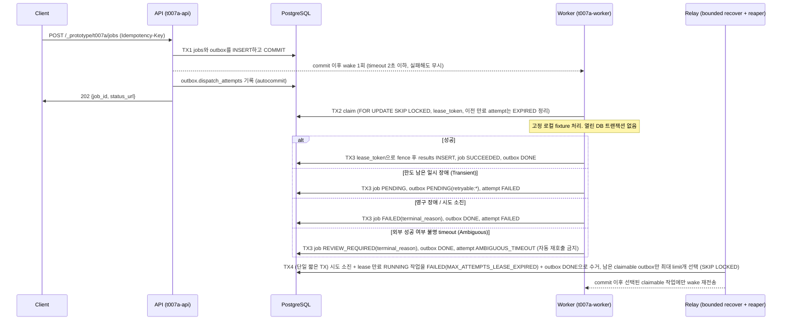

# T-007A / T-007C 로컬 Worker 수직·복구 프로토타입 (spike, 제품 코드 아님)

Cloud Run 방식 결정(OD-012) 및 비동기 실행·복구·재시도 경계 검증(`T-007A`, `T-007C`, `T-007B` 일부 기준 매핑)을 위한 **로컬 증거**입니다. API가 받은 합성 작업을 실제 PostgreSQL을 거쳐 Worker로 넘기고, wake 실패·접수 응답 유실·Worker 종료 후 lease 만료·중복 전달·외부 불확실 timeout에서도 **단일 논리 작업과 정합한 종료 상태(최대 1건 결과 또는 명시적 실패/수동 확인)**로 수렴하는지 확인합니다.

> [!IMPORTANT]
> - 제품 API 계약, 운영 스키마, 프론트엔드, AUTHDB 테스트 DB 설정과 무관합니다. 경로는 `/_prototype/t007a/*`(API)와 `/internal/t007a/*`(Worker)이고, 모든 API 응답에 `X-T007A-Prototype: not-product-api` 헤더가 붙습니다. 테이블은 별도 스키마 `t007a_spike`에만 만듭니다.
> - 클라우드 리소스(Cloud Run, Artifact Registry, Cloud Tasks, Scheduler, IAM, Supabase 프로젝트)는 하나도 만들거나 연결하지 않았으며, 실제 GitHub·LLM 호출도 하지 않습니다(고정 로컬 fixture만 사용). **호스팅된 Supabase PostgreSQL 연결·pooler·Cloud Run IAM·cold start·비용·승인은 모두 미검증(미실행)입니다.**

## 구조



| 파일 | 역할 |
|---|---|
| [t007a/schema.sql](t007a/schema.sql) | `jobs`(`PENDING`/`RUNNING`/`SUCCEEDED`/`FAILED`/`REVIEW_REQUIRED`, `terminal_reason`, UNIQUE `idempotency_key`), `outbox`(PK `job_id`), `results`(PK `job_id`), `job_attempts` |
| [t007a/api.py](t007a/api.py) | 접수(job과 outbox를 한 트랜잭션에), commit 이후 제한된 wake, 멱등 재요청, 상태·`terminal_reason`·처리 기록 조회 |
| [t007a/worker.py](t007a/worker.py) | 짧은 claim 트랜잭션, 트랜잭션 밖 고정 처리, lease 토큰 fencing 저장, 일시/영구 장애 분기, 불확실 timeout `REVIEW_REQUIRED` 격리 |
| [t007a/relay.py](t007a/relay.py) | 제한된 복구(`limit` 최대 50, `grace_s`): 시도 한도 소진 + lease 만료 작업 원자적 `FAILED` 수거 + claimable 작업 wake 재전송 |
| [t007a/fixtures.py](t007a/fixtures.py) | 외부 네트워크/GitHub/LLM 호출 없는 고정 로컬 fixture(`TransientExternalError`, `PermanentExternalError`, `AmbiguousExternalTimeoutError`) |
| [t007a/wake.py](t007a/wake.py) | `HttpWake`(1회 시도, 고정 timeout, redirect 없음)와 결과 기록 |
| [t007a/faults.py](t007a/faults.py) | **테스트 전용** 실패 주입(`api.*`, `worker.response_lost_after_save`). Python 객체로만 주입 가능하며 env/HTTP/헤더 미노출 |
| [tests/test_vertical.py](tests/test_vertical.py), [tests/test_processes.py](tests/test_processes.py) | `T-007A` 기존 16개 수직·프로세스 테스트 |
| [tests/test_t007c.py](tests/test_t007c.py) | `T-007C` 회귀·동시성·재시도·격리 9개 테스트 |
| [evidence/t007a.json](evidence/t007a.json), [evidence/latest.json](evidence/latest.json) | 보존된 `T-007A` 16건 원본 증거(`t007a.json`) 및 `T-007A + T-007C` 전체 25건 최신 실행 증거(`latest.json`) |
| [scripts/pg_local.sh](scripts/pg_local.sh) | 수동 실행용 일회성 PG(unix socket만 사용) |
| [Dockerfile](Dockerfile) | 최소 컨테이너 절차. **빌드와 실행은 하지 않았습니다**(Docker daemon 미실행) |

수용 기준에 맞춘 설계 원칙:

- FastAPI `BackgroundTasks`, 메모리 큐, 메모리 Lock을 성공 경로로 쓰지 않습니다. Worker는 wake 요청 안에서 동기로 처리합니다(최대 `T007A_MAX_JOBS_PER_WAKE`건).
- 모든 연결은 autocommit이고 트랜잭션은 `conn.transaction()`으로 명시할 때만 열립니다. 세션에 `idle_in_transaction_session_timeout=5s`, `lock_timeout=2s`, `statement_timeout=5s`를 걸었습니다. 처리 로직과 외부 HTTP wake는 항상 DB 트랜잭션 밖에서 실행됩니다.
- **시도 한도 소진 lease 만료 수거(`T-007C`)**: 마지막 시도를 선점한 Worker가 죽어 `lease_expires_at < now()`가 되면, `recover()`가 하나의 짧은 `FOR UPDATE ... SKIP LOCKED` 트랜잭션 안에서 `jobs.status='FAILED'`, `terminal_reason='MAX_ATTEMPTS_LEASE_EXPIRED'`, `job_attempts.outcome='LEASE_LOST'`, `outbox.status='DONE'`으로 정리합니다. 반복 복구는 이 작업을 다시 깨우지 않으며, 뒤늦게 깨어난 이전 Worker의 결과 저장도 `lease_token` 불일치로 거부됩니다.
- **불확실한 외부 timeout 격리(`T-007C`)**: 외부 호출 전송 이후 응답만 timeout되어 부작용 성공 여부를 알 수 없는 경우(`AmbiguousExternalTimeoutError`), 남은 `max_attempts`가 있어도 자동 재호출하지 않고 즉시 `jobs.status='REVIEW_REQUIRED'` + `outbox.status='DONE'`으로 격리하여 수동 확인 대상으로 분리합니다.

## 로컬 재현

```bash
cd spikes/t007a-worker
uv venv .venv && uv pip install -p .venv -r requirements.txt   # 또는 python -m venv / pip

# 1) 실제 로컬 일회성 PG 전체 테스트 (기존 16건 + T-007C 9건 = 25건)
unset T007A_TEST_DSN T007A_DATABASE_URL
.venv/bin/python -m pytest -v

# 2) 수동 프로세스 실행
eval "$(scripts/pg_local.sh start)"
.venv/bin/uvicorn t007a.worker:create_worker_app --factory --port 8081 &
T007A_WORKER_WAKE_URL=http://127.0.0.1:8081/internal/t007a/wake \
  .venv/bin/uvicorn t007a.api:create_api --factory --port 8080 &
curl -s -X POST localhost:8080/_prototype/t007a/jobs \
  -H 'Idempotency-Key: manual-0001' -H 'content-type: application/json' -d '{"text":"hello"}'
curl -s localhost:8080/_prototype/t007a/jobs/<job_id>
.venv/bin/python -m t007a.relay --worker-url http://127.0.0.1:8081/internal/t007a/wake --grace-s 0
kill %1 %2; scripts/pg_local.sh stop
```

환경 변수: `T007A_DATABASE_URL`(필수), `T007A_WORKER_WAKE_URL`, `T007A_WAKE_TIMEOUT_S`(기본 2, 범위 (0, 10]), `T007A_LEASE_S`(기본 30), `T007A_MAX_JOBS_PER_WAKE`(기본 5, 범위 1~50), `T007A_WORKER_ID`.

## 테스트별 DB 증거 요약 (PostgreSQL 18.3, 일회성 클러스터, 총 25건)

전체 기계 판독 증거는 [evidence/latest.json](evidence/latest.json)(`T-007A` 단독 원본은 [evidence/t007a.json](evidence/t007a.json))에 기록됩니다.

### A. T-007C 추가 검증 9건 (`tests/test_t007c.py`)

| 케이스 | 시나리오 | 최종 DB 상태 (`jobs` / `outbox` / `results` / `job_attempts`) | 시도·재시도 횟수 및 비고 |
|---|---|---|---|
| 마지막 시도 종료 후 lease 만료 | `max_attempts=1` 선점 → Worker 종료 → lease 만료 → `recover` 2회 | `FAILED:1`(`MAX_ATTEMPTS_LEASE_EXPIRED`) / `DONE:1` / `0` / `LEASE_LOST:1` | `attempt_count=1`, `reaped=1`, Worker wake `0`회, 2차 `recover` `selected=0, reaped=0` |
| 이전 Worker의 늦은 쓰기(zombie write) | 마지막 시도 만료·`FAILED` 수거 후 이전 Worker가 `_save()` 호출 | `FAILED:1`(`MAX_ATTEMPTS_LEASE_EXPIRED`) / `DONE:1` / `0` / `LEASE_LOST:1` | 늦은 `_save` 반환값 `LEASE_LOST`, 결과 `0`건 유지 |
| 복구 동시 실행 (8 스레드) | 만료 소진 2건 + 미처리 `PENDING` 2건에 8개 `recover(grace_s=5)` 동시 실행 | `FAILED:2, SUCCEEDED:2` / `DONE:4` / `2` / `LEASE_LOST:2, SUCCEEDED:2` | 합계 `reaped=2`, `selected=2`, `recovery_attempts=4` (중복 수거·중복 wake 0건) |
| 중복 wake 전달 | 동일 `job_id`로 동시 wake 6회 + 완료 후 추가 wake 1회 | `SUCCEEDED:1` / `DONE:1` / `1` / `SUCCEEDED:1` | fixture 호출 `1`회 (`attempt_count=1`), 나머지 6회는 claim `0`건 |
| 결과 저장 직후 Worker 응답 유실 | Worker가 결과 저장·COMMIT 직후 응답 유실 → API는 `wake=failed` 기록 → 이후 `recover` 및 재전송 | `SUCCEEDED:1` / `DONE:1` / `1` / `SUCCEEDED:1` | fixture 호출 `1`회, `recover` `selected=0`, 재전송 `wake=skipped` |
| 한도 내 일시 장애 재시도 | `TransientExternalError` 2회 후 3회차 성공 (`max_attempts=3`) | `SUCCEEDED:1` / `DONE:1` / `1`(`attempt_no=3`) / `FAILED:2, SUCCEEDED:1` | 총 `attempt_count=3` (초기 1 + 복구 재시도 2), 이후 `recover` `selected=0` |
| 일시 장애 한도 소진 | `TransientExternalError` 연속 발생 (`max_attempts=3`) | `FAILED:1`(`MAX_ATTEMPTS_EXHAUSTED:TransientExternalError`) / `DONE:1` / `0` / `FAILED:3` | 총 `attempt_count=3`, 이후 `recover` `selected=0, reaped=0` |
| 영구 장애 즉시 실패 | `PermanentExternalError` 발생 (`max_attempts=3`) | `FAILED:1`(`PERMANENT_FAILURE:PermanentExternalError`) / `DONE:1` / `0` / `FAILED:1` | `attempt_count=1` (재시도 `0`회), `recover` `selected=0` |
| 불확실 외부 timeout 수동 확인 분리 | `AmbiguousExternalTimeoutError` 발생 (`max_attempts=3`, 잔여 2회) | `REVIEW_REQUIRED:1`(`AMBIGUOUS_EXTERNAL_TIMEOUT:...`) / `DONE:1` / `0` / `AMBIGUOUS_TIMEOUT:1` | fixture 호출 `1`회 고정 (자동 재호출 `0`회), 이후 drain/`recover`/재전송 모두 무동작 |

### B. T-007A 기존 16건 (`tests/test_vertical.py`, `tests/test_processes.py`)

정상 경로, commit 전 실패 rollback 2건, wake 실패 후 복구, 복구 `limit`/`grace_s`, 접수 응답 유실 재전달, 응답 유실+wake 실패 동시 수렴, 동일 키 다른 body `409`, 동시 중복 접수 8스레드, 동시 Worker 8스레드, lease 만료 재선점 단일 결과, `results` PK 방어선, 처리 중 열린 트랜잭션 `0`개, 실패 주입 HTTP 미노출, `uvicorn` 2프로세스 HTTP wake 및 실제 연결 거부 복구까지 **16건 모두 회귀 없이 통과**합니다.

## T-007B 기준 매핑 및 미검증 경계

| `T-007B` 관련 기준 | 현재 스파이크(`T-007A` + `T-007C`) 충족 범위 | 미검증·별도 분리 항목 |
|---|---|---|
| 중복 전달·재시도 시 단일 결과 보장 | 동일 `Idempotency-Key` 재전달, 동시/지연 중복 wake, 결과 저장 직후 응답 유실, lease 만료 재선점 시 `lease_token` fencing + `results(job_id)` PK로 결과 최대 1건 보장 | 다단계 스트림 수집 중 **checkpoint 갱신 경쟁(concurrent checkpoint advancement / partial stream cursor fencing)**은 미구현·미검증 |
| 시도 한도·영구 실패·불확실 timeout 분리 | 일시 장애만 `max_attempts` 내에서 재시도, 한도 소진(실행 중 예외 및 Worker 종료 후 lease 만료 모두)과 영구 오류는 `terminal_reason`이 있는 `FAILED` + `outbox=DONE` 수렴, 외부 성공 여부 불명 timeout은 `REVIEW_REQUIRED`로 자동 재호출 차단 | 수동 확인(`REVIEW_REQUIRED`) 이후 운영자/제품 API의 재개·취소 계약 및 실제 외부 provider idempotency/reconciliation 조회는 미포함 |
| 멱등 키(`Idempotency-Key`) 충돌 처리 | 동일 키 + 동일 정규화 payload 재요청 시 동일 `job_id` 수렴, 다른 payload 시 `409` 거부 | 스파이크는 전역 `UNIQUE(idempotency_key)`만 사용. **제품 `Idempotency-Key` 범위(`(workspace_id, operation, idempotency_key)` 및 TTL/권한 검증, `T-105`/`T-106`)**는 제품 계약 범위로 분리 |
| DB 트랜잭션 경계 | 접수(`jobs`+`outbox`), 선점(`claim`), 결과/실패 반영, 만료 수거(`recover`) 모두 짧은 명시적 트랜잭션이며 처리·HTTP wake 중 열린 트랜잭션 `0`개 | 호스팅 환경에서의 실제 지연·락 경합 및 트랜잭션 풀러 호환성은 미실행 |

## 호스팅 환경(Cloud Run + Supabase PostgreSQL) 별도 검증 항목 — **전부 미실행(미검증)**

프로젝트 데이터베이스 기준은 Cloud SQL이 아니라 **Supabase PostgreSQL**입니다. 아래 항목은 로컬 일회성 PostgreSQL로 대체할 수 없으며 이번 작업에서 실행하지 않았습니다.

| 항목 | 로컬 전제 | 호스팅 실환경(Cloud Run + Supabase PostgreSQL)에서 확인할 것 (미실행) |
|---|---|---|
| Supabase PostgreSQL 연결 및 Pooler | 로컬 unix socket 직접 연결, 세션 옵션(`search_path`, `idle_in_transaction_session_timeout`, `lock_timeout`, `statement_timeout`) 사용 | **Supabase PostgreSQL** direct 연결 vs Supavisor pooler(transaction mode 포트 `6543` / session mode `5432`) 동작, transaction pooler 사용 시 startup `options`·prepared statement(`prepare_threshold=None`)·세션 설정 호환성, TLS/SSL 필수 여부 |
| DB 역할·권한 및 커넥션 상한 | 단일 로컬 역할 `t007a`, 작업 단위 연결 생성 | `T-007D` 최소 권한 런타임 역할(`BYPASSRLS` 없음, RLS 강제)과의 결합, Cloud Run `max-instances × concurrency` 대비 Supabase pooler/direct 연결 한도 |
| Cloud Run 실행 권한 (IAM) | Worker `/internal/*`가 무인증 상태로 `127.0.0.1`에만 바인드 | Worker 비공개 배포(`--no-allow-unauthenticated`), API 서비스 계정에 `roles/run.invoker` 부여, OIDC ID 토큰 첨부 wake, 복구 호출 주체(Scheduler 등) SA 권한 |
| Cold start 및 Wake timeout | 로컬 프로세스 상시 대기 | `min-instances=0`에서 cold start 지연이 `T007A_WAKE_TIMEOUT_S`(기본 2초)를 넘을 때의 wake 실패율과 복구 지연, 적절한 timeout 값 |
| 요청 종료·CPU 할당·시간 제한 | 요청 내 동기 처리, lease 30초 | Cloud Run request-based CPU 과금에서 호출자 timeout 종료 시 Worker 인플라이트 요청 유지/취소 여부, request timeout·`SIGTERM` 유예(10초)·`lease_s` 정합성 |
| 컨테이너 및 비용·승인 | [Dockerfile](Dockerfile) 문서화만 수행(Docker daemon 미실행으로 미빌드) | 컨테이너 이미지 빌드·기동(`PORT`, non-root), `max-instances`·복구 주기 기반 비용 상한, 예산 알림 및 배포 승인 절차 |
