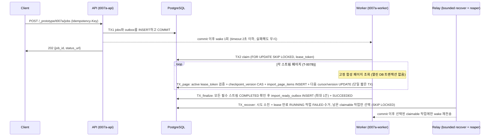

# T-007A / T-007B / T-007C 로컬 Worker 수직·복구·초기가져오기 프로토타입 (spike, 제품 코드 아님)

Cloud Run 방식 결정(OD-012) 및 비동기 실행·복구·재시도·초기가져오기 스트림 체크포인트 경계 검증(`T-007A`, `T-007C`, `T-007B`)을 위한 **로컬 증거**입니다. API가 받은 합성 작업을 실제 PostgreSQL을 거쳐 Worker로 넘기고, wake 실패·접수 응답 유실·Worker 종료 후 lease 만료·중복 전달·외부 불확실 timeout·다단계 페이지 수집 중 늦은 쓰기(zombie write)·중단 후 재개·완료 경쟁에서도 **단일 논리 작업, 페이지/체크포인트 원자성, 단 1건의 `IMPORT_READY`**로 수렴하는지 확인합니다.

> [!IMPORTANT]
> - 제품 API 계약, 운영 스키마/Migration, 프론트엔드, AUTHDB 테스트 DB 설정과 무관합니다. 경로는 `/_prototype/t007a/*`(API)와 `/internal/t007a/*`(Worker)이고, 모든 API 응답에 `X-T007A-Prototype: not-product-api` 헤더가 붙습니다. 테이블은 별도 스키마 `t007a_spike`에만 만듭니다.
> - 클라우드 리소스(Cloud Run, Artifact Registry, Cloud Tasks, Scheduler, IAM, Supabase 프로젝트)는 하나도 만들거나 연결하지 않았으며, 실제 GitHub·LLM 호출도 하지 않습니다(고정 로컬 합성 응답만 사용). **호스팅된 Supabase PostgreSQL 연결·pooler·Cloud Run IAM·cold start·비용·승인은 모두 미검증(미실행)입니다.**

## 구조



| 파일 | 역할 |
|---|---|
| [t007a/schema.sql](t007a/schema.sql) | 단일 작업(`jobs`, `outbox`, `results`, `job_attempts`) + `T-007B` 초기가져오기(`import_runs`, `import_stream_checkpoints`, `import_page_items`, `import_ready_outbox`) |
| [t007a/api.py](t007a/api.py) | 접수(job과 outbox를 한 트랜잭션에), commit 이후 제한된 wake, 멱등 재요청, 상태·`terminal_reason`·처리 기록 조회 |
| [t007a/worker.py](t007a/worker.py) | 짧은 claim 트랜잭션, 트랜잭션 밖 고정 처리, lease 토큰 fencing 저장, 일시/영구 장애 분기, 불확실 timeout `REVIEW_REQUIRED` 격리 |
| [t007a/import_run.py](t007a/import_run.py) | `T-007B` 단일 저장소 초기가져오기: 페이지 결과 + 체크포인트 원자 커밋, `lease_token` + `checkpoint_version` 이중 fencing, 안전한 재개 게이트(`UNSAFE_CHECKPOINT` / `PLAN_DRIFT` 차단), 단일 `IMPORT_READY` 확정 |
| [t007a/relay.py](t007a/relay.py) | 제한된 복구(`limit` 최대 50, `grace_s`): 시도 한도 소진 + lease 만료 작업 원자적 `FAILED` 수거 + claimable 작업 wake 재전송 |
| [t007a/fixtures.py](t007a/fixtures.py) | 외부 네트워크/GitHub/LLM 호출 없는 고정 로컬 fixture(`TransientExternalError`, `PermanentExternalError`, `AmbiguousExternalTimeoutError`) |
| [t007a/wake.py](t007a/wake.py) | `HttpWake`(1회 시도, 고정 timeout, redirect 없음)와 결과 기록 |
| [t007a/faults.py](t007a/faults.py) | **테스트 전용** 코드 내 실패 주입(`api.*`, `worker.*`, `import.*`). Python 객체로만 주입 가능하며 env/HTTP/헤더 미노출 |
| [tests/test_vertical.py](tests/test_vertical.py), [tests/test_processes.py](tests/test_processes.py) | `T-007A` 기존 16개 수직·프로세스 테스트 |
| [tests/test_t007c.py](tests/test_t007c.py) | `T-007C` 회귀·동시성·재시도·격리 9개 테스트 |
| [tests/test_t007b_import.py](tests/test_t007b_import.py) | `T-007B` 페이지+체크포인트 원자성, 늦은 쓰기 fencing, 실제 `SIGKILL` 종료 후 인수, 안전 재개/차단, `IMPORT_READY` 완료 경쟁 8개 테스트 |
| [evidence/t007a.json](evidence/t007a.json), [evidence/t007c.json](evidence/t007c.json), [evidence/latest.json](evidence/latest.json) | 보존된 `T-007A`(16건)·`T-007C`(25건) 원본 증거 및 `T-007A+C+B` 전체 33건 최신 실행 증거(`latest.json`) |

## 로컬 재현

```bash
cd spikes/t007a-worker
uv venv .venv && uv pip install -p .venv -r requirements.txt   # 또는 python -m venv / pip

# 실제 로컬 일회성 PG 전체 테스트 (T-007A 16건 + T-007C 9건 + T-007B 8건 = 33건)
unset T007A_TEST_DSN T007A_DATABASE_URL
.venv/bin/python -m pytest -v
```

## 단일 작업 멱등성 vs 페이지 재처리 멱등성 구분

| 구분 | 보장 계층과 키 | 재실행·경쟁 시 동작 |
|---|---|---|
| **단일 작업(Job) 멱등성** (`T-007A` / `T-007C`) | 접수: `jobs.idempotency_key` UNIQUE + 정규화 `request_hash`<br>저장: `jobs.lease_token` fencing + `results(job_id)` PK | 같은 요청 재전송 시 동일 `job_id` 반환. 중복 wake·재선점 시에도 `results`는 작업당 최대 1건만 저장 |
| **페이지 재처리·체크포인트 멱등성** (`T-007B`) | 선점 유효성: 활성 lease 검증(`status='RUNNING'`, `lease_token` 일치, `lease_expires_at > now()`)<br>커서 전진: `import_stream_checkpoints.checkpoint_version` CAS(`expected_version`)<br>항목 중복 방어선: `import_page_items(run_id, stream_type, external_id)` PK | 페이지 항목과 다음 `cursor`/`checkpoint_version`이 같은 트랜잭션으로 커밋/롤백됨. 커밋 후 응답 유실로 이전 페이지를 다시 제출하면 `STALE_CHECKPOINT_VERSION`으로 통째 거부되어 `checkpoint_version` 이중 전진이 없고, 페이지 간 항목 중복이 있어도 복합 PK로 1건만 유지됨 |

## 테스트별 DB 증거 요약 (PostgreSQL 18.3, 일회성 클러스터, 총 33건)

전체 기계 판독 증거는 [evidence/latest.json](evidence/latest.json)(`T-007A` 원본 [evidence/t007a.json](evidence/t007a.json), `T-007C` 원본 [evidence/t007c.json](evidence/t007c.json))에 기록됩니다.

### A. T-007B 초기가져오기 검증 8건 (`tests/test_t007b_import.py`)

| 케이스 | 장애 방식 구분 | 최종·경쟁 전후 DB 상태 |
|---|---|---|
| 커밋 전 실패 롤백 (항목 INSERT 직후 / COMMIT 직전, 2건) | 코드 내 장애 주입 (`FaultPlan`) | 실패 직후 `import_page_items=0`, `checkpoint_version=0`, `cursor=None` (둘 다 롤백) → 재실행 후 `items=2`, `version=1`, `cursor='cur-commits-p2'` |
| 커밋 후 응답 유실 + 페이지 재처리 | 코드 내 장애 주입 (`import.after_page_commit`) | 커밋 직후 `items=2, version=1` 확정; 구 페이지(`expected_version=0`) 재시도는 `STALE_CHECKPOINT_VERSION` 거부(`version=1` 유지); 중복 항목 포함 다음 페이지도 복합 PK로 총 `items=3, version=2` |
| Worker A 지연 vs Worker B 인수 늦은 쓰기 차단 (`Event` 순서 제어) | 코드 내 결정론적 순서 제어 + DB 시계 만료 | **인수 전 만료 상태**: `LEASE_EXPIRED_UNCLAIMED` 거부(`items=0, version=0`)<br>**Worker B 인수·완료 후(`items=3, version=2, cursor='cur-commits-end'`)**: A의 늦은 쓰기는 `LEASE_TAKEN_OVER`(lease 검증 시) 및 `STALE_CHECKPOINT_VERSION`(version CAS 단독 검증 시)으로 통째 거부, A의 오염 항목 `0`건 |
| 실제 자식 프로세스 `SIGKILL` 종료 후 인수·완료 | **실제 OS 프로세스 강제 종료 (`SIGKILL`, `-9`)** | 자식 프로세스가 1페이지 커밋(`items=2, IMPORT_READY=0`) 후 `SIGKILL` 종료 → lease 만료 후 Worker B가 `cur-commits-p2`부터 이어받아 `SUCCEEDED`, `items=6`, `IMPORT_READY=1` |
| 정상 실행 vs 중단·재개 논리 동치 | 정상 완료 vs `PARTIAL` 중단 후 `prepare_safe_resume` | 두 실행의 논리 상태(`streams` 커서/버전/개수, 6개 `items` 내용, `IMPORT_READY=1`) 100% 일치; 중단 시점에는 `IMPORT_READY=0` |
| 불안전 체크포인트 / 계획 변경 재개 차단 | `safe_checkpoint=false` / `plan_fingerprint` 불일치 | 불안전 체크포인트는 `UNSAFE_CHECKPOINT`(`PARTIAL`, `IMPORT_READY=0`)로 차단; 계획 변경은 `PLAN_DRIFT`(`source_drift=true`, `PARTIAL`, `IMPORT_READY=0`)로 동일 run 자동 재개 차단 |
| 필수 스트림 완료 전 `0`건 + 완료 경쟁(8스레드) 후 `1`건 | 8개 스레드 동시 `try_finalize_import_run` | `PULL_REQUESTS` 미완료 시 `IMPORT_READY=0`(`incomplete=['PULL_REQUESTS']`); 완료 직후 8스레드 동시 경쟁에서 `emitted_import_ready` `true:1, false:7`, `import_ready_outbox=1` |

### B. T-007C 9건 (`tests/test_t007c.py`) 및 T-007A 16건 (`tests/test_vertical.py`, `tests/test_processes.py`)

마지막 시도 Worker 종료 + lease 만료 `FAILED(MAX_ATTEMPTS_LEASE_EXPIRED)` 수거, 수거 후 좀비 Worker 늦은 쓰기 차단, 8스레드 동시 복구, 중복 wake, 결과 저장 직후 응답 유실, 일시/영구 장애 재시도 한도, 불확실 외부 timeout `REVIEW_REQUIRED` 격리, `uvicorn` 2프로세스 HTTP wake/복구 등 **기존 25건 모두 회귀 없이 통과**합니다.

## 남은 계약·후속 리스크 분리 (확정·구현 제외 항목)

- **제품 `Idempotency-Key` 범위·보존 기간 (`T-105` / `T-106` 승인 대기)**: 본 스파이크는 로컬 검증용 전역 `UNIQUE(idempotency_key)`만 사용합니다. Workspace/연산 단위 복합 키 범위, 권한 검증, 키 TTL/보존 정책은 `T-105`/`T-106` 승인 전 확정하지 않습니다.
- **외부 부작용 요청 전송 직후 프로세스 종료 위험**: 코드 내에서 포착된 timeout(`AmbiguousExternalTimeoutError`)은 `REVIEW_REQUIRED`로 격리하지만, 외부 변경 요청을 소켓에 쓴 직후 Worker 프로세스가 `SIGKILL`/크래시로 죽어 DB에 시도 중 기록조차 갱신하지 못한 채 lease가 만료되면 DB만으로는 외부 부작용 발생 여부를 알 수 없습니다. 부작용이 있는 외부 호출 전 사전 의도 기록(pre-flight intent log / provider idempotency key)과 `REVIEW_REQUIRED` 수동 해제·대조(reconciliation) 절차는 별도 후속 항목입니다.
- **호스팅 환경(Cloud Run + Supabase PostgreSQL) 미실행 항목**: 호스팅된 **Supabase PostgreSQL** 실제 연결 및 Supavisor pooler(transaction/session mode, `prepare_threshold=None`, 세션 옵션 호환성), `T-007D` RLS 역할 결합, Cloud Run 비공개 IAM(`roles/run.invoker`, OIDC 토큰), `min-instances=0` cold start, request timeout/`SIGTERM` 유예, Docker 이미지 빌드·기동, 비용·승인 검증은 **실행하지 않았습니다(미검증)**.
