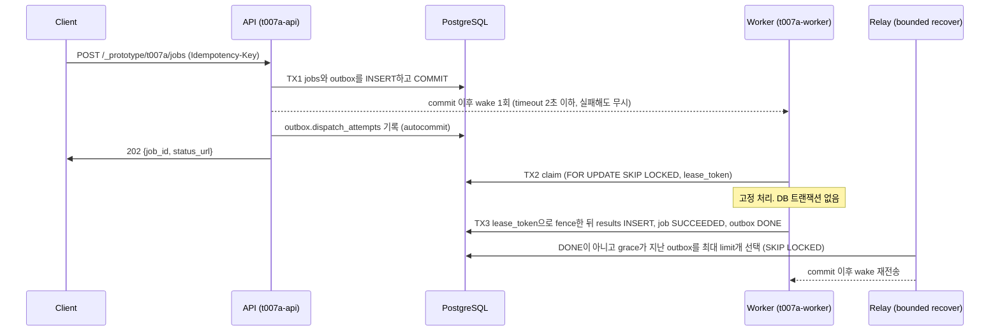

# T-007A 로컬 Worker 수직 프로토타입 (spike, 제품 코드 아님)

Cloud Run 방식 결정(OD-012)을 위한 **로컬 증거**입니다. API가 받은 합성 작업을 실제 PostgreSQL을 거쳐 Worker로 넘기고, wake 신호가 실패하거나 접수 응답이 사라져도 **같은 job ID와 결과 1건**으로 수렴하는지만 확인합니다.

> [!IMPORTANT]
> - 제품 API 계약, 운영 스키마, 프론트엔드, AUTHDB 테스트 DB 설정과 무관합니다. 경로는 `/_prototype/t007a/*`(API)와 `/internal/t007a/*`(Worker)이고, 모든 API 응답에 `X-T007A-Prototype: not-product-api` 헤더가 붙습니다. 테이블은 별도 스키마 `t007a_spike`에만 만듭니다.
> - Cloud Run, Artifact Registry, Cloud Tasks, Scheduler, IAM, CI/CD는 하나도 만들거나 바꾸지 않았습니다. **Cloud Run 호환성, 비용, 승인은 검증하지 않았습니다.**

## 구조



| 파일 | 역할 |
|---|---|
| [t007a/schema.sql](t007a/schema.sql) | `jobs`(UNIQUE `idempotency_key`), `outbox`(PK `job_id`), `results`(PK `job_id`, 중복 방지 장치), `job_attempts`(처리 기록) |
| [t007a/api.py](t007a/api.py) | 접수(job과 outbox를 한 트랜잭션에), commit 이후 제한된 wake, 멱등 재요청, 상태와 처리 기록 조회 |
| [t007a/worker.py](t007a/worker.py) | 짧은 claim 트랜잭션, 트랜잭션 밖 고정 처리, lease로 fence한 저장, `/internal/t007a/wake`, `/internal/t007a/recover` |
| [t007a/relay.py](t007a/relay.py) | 제한된 outbox 복구(`limit` 최대 50, `grace_s`)와 CLI |
| [t007a/wake.py](t007a/wake.py) | `HttpWake`(1회 시도, 고정 timeout, redirect 없음)와 결과 기록 |
| [t007a/faults.py](t007a/faults.py) | **테스트 전용** 실패 주입. Python 객체로만 넣을 수 있고 env, HTTP, 헤더로는 켤 수 없습니다 |
| [tests/](tests) | 실제 PG 테스트(in-process 14건, uvicorn 2개 프로세스 2건). 증거는 [evidence/latest.json](evidence/latest.json) |
| [scripts/pg_local.sh](scripts/pg_local.sh) | 수동 실행용 일회성 PG(unix socket만 사용) |
| [Dockerfile](Dockerfile) | 최소 컨테이너 절차. **빌드와 실행은 하지 않았습니다**(Docker daemon이 꺼져 있었음) |

수용 기준에 맞춘 설계 원칙:

- FastAPI `BackgroundTasks`, 메모리 큐, 메모리 Lock을 쓰지 않습니다. Worker는 wake 요청 안에서 동기로 처리합니다(최대 `T007A_MAX_JOBS_PER_WAKE`건).
- 모든 연결은 autocommit이고 트랜잭션은 `conn.transaction()`으로 명시할 때만 열립니다. 세션에 `idle_in_transaction_session_timeout=5s`, `lock_timeout=2s`, `statement_timeout=5s`를 걸었습니다. 외부 HTTP 호출과 처리 로직은 항상 트랜잭션 밖에서 실행됩니다(테스트에서 `pg_stat_activity`로 확인).
- DB 소유권과 wake를 분리했습니다. 처리해야 할 일의 원본은 `outbox` 행이고, wake는 힌트일 뿐입니다. wake가 실패하면 `outbox.status='PENDING'`과 `last_error`가 남고 복구가 이를 집어 갑니다.

## 로컬 재현

```bash
cd spikes/t007a-worker
uv venv .venv && uv pip install -p .venv -r requirements.txt   # 또는 python -m venv / pip

# 1) 실제 PG 테스트. initdb(PATH, $PG_BIN, Homebrew postgresql@16~18)로 일회성 클러스터를 띄웁니다.
#    이미 있는 일회성 DB를 쓰려면 T007A_TEST_DSN=... 를 지정합니다(t007a_spike 스키마를 DROP합니다).
#    PG가 없으면 모든 테스트가 SKIP되고, SQLite나 stub으로 대체하지 않습니다.
.venv/bin/python -m pytest -v

# 2) 수동 프로세스 실행
eval "$(scripts/pg_local.sh start)"
.venv/bin/uvicorn t007a.worker:create_worker_app --factory --port 8081 &
T007A_WORKER_WAKE_URL=http://127.0.0.1:8081/internal/t007a/wake \
  .venv/bin/uvicorn t007a.api:create_api --factory --port 8080 &
curl -s -X POST localhost:8080/_prototype/t007a/jobs \
  -H 'Idempotency-Key: manual-0001' -H 'content-type: application/json' -d '{"text":"hello"}'
curl -s localhost:8080/_prototype/t007a/jobs/<job_id>
.venv/bin/python -m t007a.relay --worker-url http://127.0.0.1:8081/internal/t007a/wake --grace-s 0
kill %1 %2; scripts/pg_local.sh stop
```

환경 변수: `T007A_DATABASE_URL`(필수), `T007A_WORKER_WAKE_URL`, `T007A_WAKE_TIMEOUT_S`(기본 2, 범위 (0, 10]), `T007A_LEASE_S`(기본 30), `T007A_MAX_JOBS_PER_WAKE`(기본 5, 범위 1~50), `T007A_WORKER_ID`.

## 테스트별 DB 증거 (PostgreSQL 18.3, 일회성 클러스터)

숫자는 각 테스트에서 assert한 값이고, 전체 내용은 [evidence/latest.json](evidence/latest.json)에 있습니다. 표기는 `jobs / outbox / results / attempts`입니다.

| 케이스 | 실패 직후 | 수렴 후 |
|---|---|---|
| 정상 경로 | – | SUCCEEDED 1 / DONE 1 / 1 / SUCCEEDED 1. wake 시점에 다른 세션에서 job이 보였고 열린 app 트랜잭션은 0개 |
| commit 전 실패(job과 outbox 사이) | 0 / 0 / 0 / 0, wake 호출 0회 | 같은 요청을 재시도하면 SUCCEEDED 1 / DONE 1 / 1 / 1 |
| commit 전 실패(outbox 이후, commit 전) | 0 / 0 / 0 / 0, wake 호출 0회 | 같은 요청을 재시도하면 SUCCEEDED 1 / DONE 1 / 1 / 1 |
| commit 후 wake 실패와 제한된 복구 | PENDING 1 / PENDING 1(`wake_failed:injected`) / 0 / 0 | `recover(limit=1)` 결과 selected 1. SUCCEEDED 1 / DONE 1 / 1 / 1. 다시 recover하면 selected 0 |
| 복구 상한과 grace | 5건 모두 PENDING | grace=3600이면 selected 0. limit=2이면 SUCCEEDED 2 / PENDING 3. 비어 있지 않은 라운드 3번 뒤 5 / 5 / 5 / 5 |
| 접수 응답 유실 후 같은 입력 재전달 | SUCCEEDED 1 / DONE 1 / 1 / 1(클라이언트는 job_id를 받지 못함) | 재요청 결과는 `replayed=true`, DB의 job_id와 같고, wake는 `skipped`. 행 수 변화 없음 |
| 응답 유실과 wake 실패가 겹친 경우 | PENDING 1 / PENDING 1 / 0 / 0 | 재요청 시 wake를 1회 다시 보내 SUCCEEDED 1 / DONE 1 / 1 / 1. recover는 selected 0. 세 번째 재요청은 `skipped` |
| 같은 키에 다른 body | – | 409. job 1개 유지 |
| 동시 중복 접수 8건 | – | job_id 1종류. 1 / 1 / 1 / 1. `dispatch_attempts=1`(wake 증폭 없음) |
| 동시 Worker 8개 | – | claim 1회. 1 / 1 / 1 / 1 |
| lease 만료 후 중복 처리 | – | SUCCEEDED 1 / DONE 1 / results 1(attempt 2, `w-fast`) / LEASE_LOST 1, SUCCEEDED 1 |
| results PK 중복 방지 장치 | 직접 두 번째 INSERT하면 `UniqueViolation` | results 1 |
| 처리 중 트랜잭션 없음 | 처리 중 `pg_stat_activity` 열린 app 트랜잭션 0개, job RUNNING(대조군에서는 1개로 검출됨) | 1 / 1 / 1 / 1 |
| 실패 주입 미노출 | API 라우트는 jobs, jobs/{id}, healthz만 있음. `/_prototype/t007a/faults`는 404 | – |
| [프로세스] HTTP wake 정상 | – | uvicorn 2개 프로세스. SUCCEEDED / DONE / 1 / 1 |
| [프로세스] Worker 접속 불가 후 recover endpoint | PENDING / PENDING(`wake_failed:ConnectError`, 실제 연결 거부) / 0 / 0 | `/internal/t007a/recover` 결과 selected 1. SUCCEEDED / DONE / 1 / 1. 다시 호출하면 0 |

## Cloud Run에서 따로 검증할 항목 (이번에 검증하지 않음)

| 항목 | 로컬 전제 | Cloud Run에서 확인할 것 |
|---|---|---|
| 실행 권한 | Worker `/internal/*`가 무인증 상태로 127.0.0.1에만 바인드 | Worker 비공개(`--no-allow-unauthenticated`), API SA에 `run.invoker` 부여, OIDC ID 토큰을 붙인 wake, 복구 트리거(Scheduler)의 SA |
| cold start | 프로세스가 이미 떠 있음 | min-instances=0일 때 첫 wake 지연이 `T007A_WAKE_TIMEOUT_S`(2초)를 넘는지, 넘으면 `failed`로 기록된 뒤 복구에 의존하게 되는지, timeout 값과 재요청 정책 |
| 요청 종료와 CPU | Worker가 요청 안에서 동기로 처리함 | request-based 과금에서 응답 후 CPU가 throttle되는지(이 설계는 응답 전에 처리가 끝나야 함), wake 호출자가 timeout으로 끊었을 때 Worker 요청이 계속 실행되는지 아니면 취소되는지 |
| 시간 제한 | lease 30초, wake timeout 2초 | Cloud Run request timeout과 lease, 처리 시간의 관계. 인스턴스 SIGTERM 이후 10초 안에 RUNNING이 lease 만료로 회수되는지 |
| 동시성과 커넥션 | 작업 단위마다 새 연결 | max-instances × concurrency × 연결 수가 Cloud SQL 연결 상한을 넘지 않는지, 커넥터나 pool 선택 |
| 비용 상한 | 없음 | max-instances, 복구 주기, wake 횟수 상한. 예산 알림. 승인 절차 |
| 네트워크와 DB | unix socket으로 연결한 로컬 PG | Cloud SQL 연결 방식(커넥터, private IP), TLS, IAM DB 인증 |
| 컨테이너 | Dockerfile만 있고 빌드하지 않음 | 이미지 빌드, `PORT` 준수, non-root 실행 확인 |

## 알려진 한계와 결정이 필요한 항목

- wake 전달 방식(T-007B/C 범위): 지금은 API가 Worker에 HTTP로 직접, 동기로 wake를 보내고 2초 timeout을 겁니다. Worker는 요청 안에서 처리합니다. 처리 시간이 timeout보다 길면 API는 `failed`로 기록하지만 Worker는 실제로 처리하고 있을 수 있습니다. 결과는 멱등이라 정합성은 맞지만 불필요한 복구 wake가 생깁니다. Cloud Tasks처럼 dispatch deadline이 있는 큐를 쓸지, 직접 호출을 쓸지 결정해야 합니다.
- 재요청 wake 정책: 재요청은 이전 wake가 확실히 실패했을 때(`PENDING`이고 `last_error` 있음)만 wake를 다시 보냅니다. commit과 wake 사이에 API가 죽으면(오류 기록 없음) grace가 지난 뒤 복구에만 의존합니다.
- 재시도와 poison 정책: 처리 예외가 나면 `max_attempts=3`까지 PENDING으로 되돌리고 그 뒤 FAILED로 둡니다. `attempt_count`가 상한에 도달한 RUNNING job의 lease가 만료되면 claim도 FAILED 전환도 되지 않아 RUNNING에 머물고, 복구는 grace마다 이 job에 wake를 다시 보냅니다. 이 경우와 backoff는 구현하지 않았습니다.
- 복구 트리거: 함수, CLI, Worker endpoint로 제공합니다. 주기 실행(Scheduler)은 범위 밖입니다.
- Idempotency-Key 범위는 전역 UNIQUE입니다. 제품에서는 workspace/actor 단위로 범위를 정해야 하고, 이는 제품 API 계약(T-105/T-106)이 결정합니다.
- 테스트는 macOS의 Python 3.14.3, psycopg 3.3.9, FastAPI 0.165.0으로 실행했습니다. Dockerfile 기본 이미지는 3.12이고 검증하지 않았습니다.
